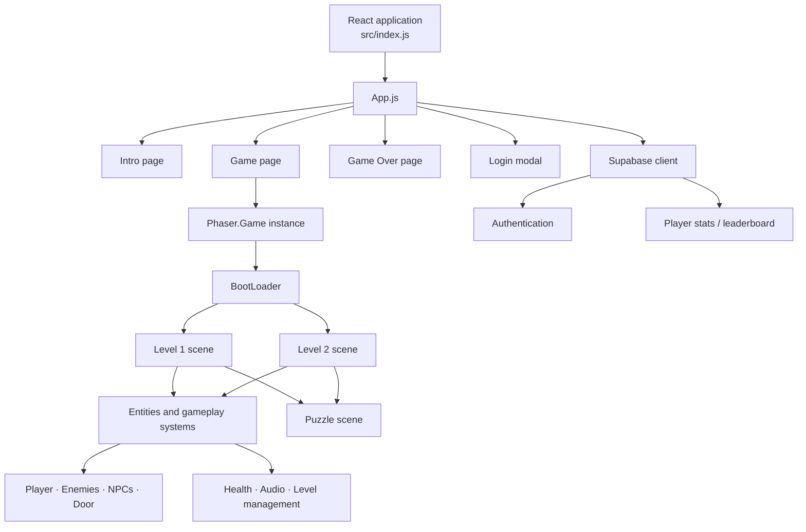
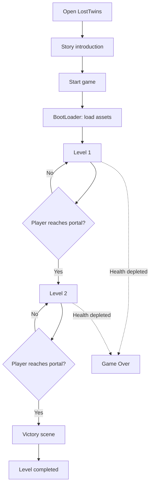

# LostTwins

**LostTwins** is a browser-based 2D platform game built with React and Phaser. It follows Ilyra, the spirit of water, and Brynna, the spirit of the forest, two sisters separated after a powerful tempest tears their valley apart. The player explores different environments, fights enemies, interacts with NPCs and completes puzzle challenges while progressing through the story.

This project was developed collaboratively by **Anthony Frade and Valezka Naia** as a web development project. It combines a React-based application interface with a Phaser game runtime.

## Table of contents

- [Features](#features)
- [Technology stack](#technology-stack)
- [Architecture](#architecture)
- [Gameplay systems](#gameplay-systems)
- [Project structure](#project-structure)
- [Game flow](#game-flow)
- [Controls](#controls)
- [Getting started](#getting-started)
- [Supabase configuration](#supabase-configuration)
- [Development scripts](#development-scripts)
- [Technical notes](#technical-notes)

## Features

- **Story-driven introduction:** a scrolling introduction presents the game's setting and story chapters.
- **2D platform gameplay:** explore two levels built with tilemaps and platform collision.
- **Character movement and combat:** move, jump and attack using keyboard controls.
- **Enemy behaviour:** enemies patrol platforms, detect nearby players, attack and react to damage.
- **NPC interactions:** approach NPCs and use the interaction key to access puzzle challenges.
- **Puzzle minigame:** solve a 5×5 drag-and-drop image puzzle.
- **Health and scoring:** the game tracks player health and awards points for defeating enemies.
- **Audio feedback:** background music and sound effects accompany gameplay.
- **Account interface:** Supabase authentication is integrated for email/password and Google sign-in.
- **Leaderboard interface:** the React application queries player high scores from Supabase.

## Technology stack

| Technology | Role |
|---|---|
| React 19 | Application interface, page-level state and UI composition |
| Phaser 3 | 2D game runtime, scenes, rendering, input and Arcade Physics |
| JavaScript | Game logic and application behaviour |
| CSS | Application, page and game interface styling |
| Framer Motion | UI transitions and interaction animations |
| Supabase | Authentication and player score data |
| Lucide React | Interface icons |
| Tiled tilemap JSON | Level map data loaded by Phaser |

## Architecture

LostTwins uses a **React + Phaser architecture**. React manages the surrounding web application, while Phaser is responsible for the real-time game. The two parts are integrated through a React component that creates and destroys the Phaser game instance.



### 1. React application layer

The React application is the entry point for the website.

- `src/index.js` mounts the React application.
- `src/App.js` manages the main application view, authentication session, login modal and game-over data.
- `src/pages/Intro.js` displays the story introduction and starts the game.
- `src/pages/Game.js` creates the Phaser instance, displays the score and timer interface, and destroys the game instance when the component unmounts.
- `src/pages/GameOver.js` presents the final score, leaderboard and restart/menu actions.
- `src/login/` contains the login interface and Supabase client.

React is therefore responsible for the website-level experience, while the actual platform gameplay runs inside the Phaser canvas.

### 2. Phaser game layer

`src/pages/Game.js` configures and starts Phaser. The configuration uses:

- `Phaser.AUTO` for renderer selection.
- A 1000 × 500 game viewport.
- Arcade Physics with vertical gravity.
- A scene list containing the loader, levels, puzzle and end-game scenes.

The Phaser scenes divide the game into separate stages:

| Scene | Responsibility |
|---|---|
| `BootLoader` | Loads tilemaps, spritesheets, images and audio; creates character and object animations |
| `Level1Scene` | Creates the first level, entities, collisions, combat and exit |
| `Level2Scene` | Creates the second level with its own map, entities and interactions |
| `PuzzleScene` | Displays and manages the puzzle minigame |
| `GameOverScene` | Phaser game-over screen and score-related interface |
| `VictoryScene` | Displays the level-completion screen |

### 3. Entity layer

The entity classes encapsulate the behaviour of the main game objects.

- **Player (`Player.js`):** extends `Phaser.Physics.Arcade.Sprite`. Handles movement, jumping, directional animation, attack input, an attack hitbox and damage feedback. The animation prefix allows the levels to use different player sprite sets.
- **Enemy (`Enemy.js`):** extends the Phaser Arcade Sprite class. Handles patrol movement, direction changes at walls/platform edges, health, damage, attack animations and player detection.
- **NPC (`NPC.js`):** represents an interactable non-player character. Displays an interaction prompt when the player is nearby.
- **Door (`Door.js`):** represents the animated portal used to leave a level.

### 4. Gameplay systems

Gameplay responsibilities are separated into small system classes.

| System | Responsibility |
|---|---|
| `HealthSystem.js` | Tracks current and maximum health, applies damage and checks whether health has reached zero |
| `GameState.js` | Holds shared game values such as health, score, current level and game-over state |
| `LevelManager.js` | Handles level completion, progression and game restart logic |
| `AudioSystem.js` | Registers and plays scene audio, stops sounds and supports fade-out |

The levels use Phaser's Arcade Physics for player, enemy, NPC, ground and attack-zone interactions. The player has a separate attack zone that is enabled during attacks, allowing the level scene to detect hits against enemies.

### 5. Puzzle minigame

The puzzle is implemented separately from the platform gameplay.

`PuzzleScene.js` creates an HTML container above the Phaser canvas and calls `initPuzzle()` from `PuzzleGame.js`. The puzzle logic uses standard browser DOM and drag-and-drop events rather than Phaser game objects.

The puzzle:

1. Selects one of three available images.
2. Builds a 5 × 5 board containing 25 pieces.
3. Displays a faint complete-image guide behind the board.
4. Lets the player drag pieces from the inventory into the board.
5. Checks whether each piece was dropped into its matching position.
6. Calls the completion callback when all 25 pieces are correctly placed.

When the puzzle is closed or completed, the HTML container is removed and the previous Phaser scene resumes.

### 6. Authentication and player data

The Supabase integration is located in `src/login/`.

- `supabase.js` creates the Supabase client.
- `loginpage.js` provides email/password sign-up and sign-in, plus Google OAuth.
- `App.js` listens for authentication session changes.
- The application queries the `player_stats` table to retrieve the top five high scores.
- When the game-over handler receives a score for an authenticated user, it reads the existing high score and upserts the latest score and the higher of the old and new scores.

The leaderboard integration expects a `player_stats` table with the fields `user_id`, `user_email`, `last_score` and `high_score`. Database permissions and row-level security policies must be configured in Supabase.

## Project structure

The main application is inside `LostTwins/losttwins/`.

```text
losttwins/
├── public/
│   ├── assets/
│   │   ├── images/             # Story and interface images
│   │   ├── enemy1/             # Enemy animation spritesheets
│   │   ├── player2/            # Second character spritesheets
│   │   ├── level2/             # Second level tileset images
│   │   ├── level1.json         # First Tiled map
│   │   └── level2.json         # Second Tiled map
│   ├── image-puzzle/           # Images used by the puzzle minigame
│   ├── sounds/                 # Music and sound effects
│   └── index.html
│
├── src/
│   ├── components/
│   │   ├── ui/                 # Reusable HUD components
│   │   └── Dock.js
│   ├── components1/
│   │   └── components/
│   │       ├── Maps/           # Phaser scenes and level setup
│   │       ├── entities/       # Player, enemy, NPC and door classes
│   │       ├── systems/        # Health, audio, state and level systems
│   │       └── puzzle_test/    # Puzzle minigame implementation
│   ├── data/                   # Story and game data
│   ├── login/                  # Login UI and Supabase client
│   ├── pages/                  # Intro, game and game-over pages
│   ├── styles/                 # Application and page stylesheets
│   ├── App.js                  # Main application component
│   └── index.js                # React entry point
│
├── package.json
└── package-lock.json
```

## Game flow



## Controls

| Key | Action |
|---|---|
| `A` | Move left |
| `D` | Move right |
| `W` | Jump |
| `Q` | Attack |
| `X` | Interact with a nearby NPC |

The NPC interaction prompt is displayed when the player is within interaction range.

## Getting started

### Prerequisites

- Node.js and npm.
- A modern web browser.

### Installation

1. Clone the repository:

   ```bash
   git clone https://github.com/nyfrade/Web-Development-Final.git
   ```

2. Navigate to the actual React application directory:

   ```bash
   cd Web-Development-Final/LostTwins/losttwins
   ```

3. Install dependencies:

   ```bash
   npm install
   ```

4. Start the development server:

   ```bash
   npm start
   ```

5. Open the local URL printed by Create React App (normally `http://localhost:3000`).

### Production build

To create an optimised production build:

```bash
npm run build
```

The generated files are placed in the `build/` directory.

## Supabase configuration

The project uses Supabase for authentication and player statistics.

Before deploying your own instance:

1. Create a Supabase project.
2. Configure the authentication providers you want to support (email/password and, optionally, Google OAuth).
3. Create the `player_stats` table with the columns used by the application.
4. Configure appropriate Row Level Security (RLS) policies for reading leaderboard data and inserting/updating a user's own score.
5. Configure the Supabase URL and publishable/anonymous client key through environment variables rather than keeping project configuration directly in source code.

For Create React App, environment variables exposed to the browser must use the `REACT_APP_` prefix. For example, create a local `.env` file:

```env
REACT_APP_SUPABASE_URL=your_supabase_project_url
REACT_APP_SUPABASE_ANON_KEY=your_supabase_publishable_or_anon_key
```

Update `src/login/supabase.js` to read these variables with `process.env.REACT_APP_SUPABASE_URL` and `process.env.REACT_APP_SUPABASE_ANON_KEY`. Do not put a Supabase service-role key in frontend code.

## Development scripts

| Command | Description |
|---|---|
| `npm start` | Starts the local development server |
| `npm run build` | Creates a production build |
| `npm test` | Runs the test suite |
| `npm run eject` | Ejects the Create React App configuration (irreversible) |

## Technical notes

- The game is embedded in React through a Phaser instance created in the `Game` page component.
- Phaser scenes own the real-time game loop, physics and in-game entities.
- The puzzle uses DOM elements and browser drag-and-drop, layered above the Phaser canvas.
- Level maps are JSON tilemaps loaded from `public/assets/`.
- The repository contains both React-level and Phaser-level game-over components. Review the intended game-over flow before extending or consolidating these screens.
- Supabase credentials are currently configured directly in `src/login/supabase.js` in the supplied source. Move configuration to environment variables before publishing or deploying the project.

---

**LostTwins** combines browser-based application development with 2D game programming, bringing together React, Phaser, physics-based gameplay, modular entities, interactive puzzles and online player data.


## Contributors

- Anthony Frade
- Valezka Naia

Both contributors collaborated on the project. Individual task ownership should be described separately only where it can be verified from the development history or team records.
